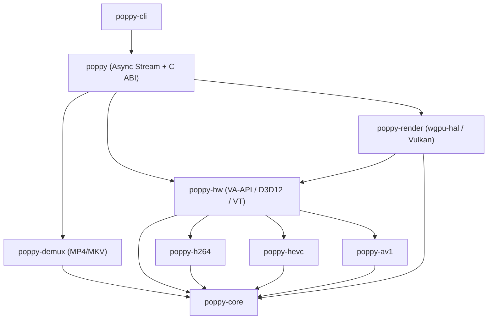

# Project Poppy: Architectural Guide & Technical Specification

> **Version:** 0.6.1  
> **Status:** Active Development & Stabilization  
> **Repository:** [https://github.com/kuntal-devrat/poppy](https://github.com/kuntal-devrat/poppy)

---

## 1. Executive Summary

**Project Poppy** is a modern, memory-safe media pipeline designed from the ground up in Rust (2024 Edition) to deliver high-throughput, low-latency video demuxing and hardware-accelerated video decoding.

Unlike legacy multimedia frameworks that rely on decades-old C codebases fraught with memory safety vulnerabilities and buffer-copy overheads, Poppy guarantees:
1. **Safe Container Demuxing**: Zero unsafe code in container demuxers (ISOBMFF/MP4 and EBML/Matroska) and bitstream header parsers (H.264, HEVC, AV1, VP9).
2. **Zero-Copy Presentation**: Decoded video frames remain in GPU VRAM from hardware decode through presentation using DRM PRIME DMA-BUF on Linux, with DXGI and Metal zero-copy pathways supported in architecture.
3. **Async Streaming**: Tokio stream interface providing bounded backpressure, stream scrubbing, and keyframe seeking.
4. **C ABI Interface**: Native shared library (`libpoppy.so`, `poppy.h`) providing C-compatible entry points with panic barriers and error reporting.

---

## 2. Workspace Modular Architecture

Poppy is organized as a unified Cargo workspace consisting of decoupled, highly focused crates:

```
poppy/
├── crates/
│   ├── poppy-core/       # Foundational types, timebase arithmetic, packet abstractions
│   ├── poppy-demux/      # Pure safe-Rust container parsers (MP4 & MKV/WebM)
│   ├── poppy-h264/       # H.264/AVC bitstream, NALU, SPS/PPS, and slice parsing
│   ├── poppy-hevc/       # HEVC/H.265 bitstream, VPS/SPS/PPS, 10-bit HDR detection
│   ├── poppy-av1/        # AV1 Open Bitstream Unit (OBU) and sequence/frame headers
│   ├── poppy-hw/         # Hardware acceleration abstraction & Decoded Reference Picture Buffer (DPB)
│   ├── poppy-render/     # Zero-copy wgpu/Vulkan/DirectX/Metal rendering subsystem
│   └── poppy/            # Ergonomic facade, Tokio async stream, and C ABI (libpoppy)
├── bins/
│   └── poppy-cli/        # CLI media inspector, benchmark tool, and interactive wgpu player
├── include/
│   └── poppy.h           # Canonical C ABI public header
├── fuzz/                 # libFuzzer and cargo-fuzz regression harness
└── docs/
    └── ARCHITECTURE.md   # This document
```

### Component Roles & Dependency Flow



---

## 3. Demuxing Engine (`poppy-demux`)

`poppy-demux` implements pure Rust streaming and random-access container parsing without allocating full file buffers into memory.

### ISOBMFF / MP4 (`poppy_demux::isobmff`)
- **Box Parsing Hierarchy**: Full recursive parsing of `ftyp`, `moov`, `mvhd`, `trak`, `tkhd`, `mdia`, `mdhd`, `hdlr`, `minf`, `stbl`, and `mdat`.
- **Sample Table Resolution (`stbl`)**:
  - Sample-to-chunk (`stsc`) and Chunk offsets (`stco` / `co64`).
  - Sample sizes (`stsz` / `stz2`) and Sample-to-time (`stts`).
  - Composition time offsets (`ctts`) for B-frame display timestamp recalculation.
  - Sync sample index (`stss`) for $O(\log N)$ binary search seeking to preceding IDR keyframes.
- **Bitstream Pass-Through**: Codec Private records parsed for `avcC` (H.264), `hvcC` (HEVC), and `av1C` (AV1). Audio tracks (AAC, Opus, FLAC) pass through without alteration.

### EBML / Matroska (`poppy_demux::matroska`)
- **VINT Decoding**: Variable-size octet decoding with strict bounds and overflow checks.
- **Segment Tree Traversal**: `Segment` -> `Tracks` -> `Cluster` -> `SimpleBlock` / `BlockGroup`.
- **SeekHead Resolution**: Reads `SeekHead` and `Cues` elements to instantly jump to keyframes anywhere in multi-gigabyte files.

---

## 4. Elementary Bitstream Parsers

Bitstream parsing is split into dedicated zero-allocation crates operating directly over slice references:

### `poppy-h264`
- **NAL Unit Demarcation**: Handles 3-byte and 4-byte start-codes (`0x000001` and `0x00000001`) as well as 4-byte length-prefixed AVC1 formats.
- **Parameter Sets**: Sequence Parameter Set (SPS) and Picture Parameter Set (PPS) parser with full Exponential-Golomb ($UE/SE$) decoders.
- **Slice Header & POC**: Extracts frame type (I, P, B), slice header, and calculates Picture Order Count (POC) for display reordering.
- **MBAFF / PAFF Interlace Detection**: Inspects `frame_mbs_only_flag`, `mb_adaptive_frame_field_flag`, and `field_pic_flag` to route interlaced streams cleanly through hardware deinterlacing or progressive fallback.

### `poppy-hevc`
- **Parameter Set Triad**: Video Parameter Set (VPS), Sequence Parameter Set (SPS), and Picture Parameter Set (PPS).
- **High-Bit-Depth Support**: Detects Main, Main 10, and Main Still Picture profiles for 10-bit HDR (P010 / Rec.2020) rendering.
- **Multi-Slice Batching**: Batches multiple slice segments belonging to a single coded picture into contiguous VA-API / D3D12 slice parameter arrays, preventing fragmented decode dispatches.

### `poppy-av1`
- **OBU Demarcation**: Parses Open Bitstream Unit headers with LEB128 variable-length integer parsing.
- **Sequence Header & Frame Header**: Extracts color configuration (8-bit vs 10-bit, sub-sampling, color primaries), loop filter parameters, CDEF, and reference frame assignment.
- **Tiles**: Uniform and non-uniform spacing up to 64x64, `large_scale_tile` support, 64-entry `width/height_in_sbs_minus_1`.

### `poppy-vp9`
- **Uncompressed header**: frame marker/sync, profile/bit-depth/colour, inter dimensions via `ref_dims` (error when missing), segmentation `alt_q` as i16 (-255..255), superframe exact-fit validation.

### `poppy-audio`
- **Symphonia AAC/MP3/FLAC + opus-decoder Opus + cpal sink** with explicit channel mapping and gapless-friendly defaults. Vorbis unsupported (returns UnsupportedCodec).

---

## 5. Hardware Acceleration Subsystem (`poppy-hw`)

The hardware acceleration layer defines the unified `HwDecoder` trait:

```rust
pub trait HwDecoder: Send {
    fn submit_packet(&mut self, packet: &Packet) -> Result<(), HwError>;
    fn receive_frame(&mut self) -> Result<Option<DecodedFrame>, HwError>;
    fn flush(&mut self) -> Result<(), HwError>;
    fn reset(&mut self) -> Result<(), HwError>;
```

### Backend Implementations

1. **Linux: VA-API (`VaapiDecoder`) [Production]**:
   - Implements hardware decoding on Intel (i965 / Intel Media Driver) and AMD (Radeon radeonsi) hardware via `libva.so.2`.
   - Profiles: `VAProfileH264High`, `VAProfileHEVCMain`, `VAProfileHEVCMain10`, `VAProfileAV1Profile0`.
   - Surface Export: Maps hardware decoding surfaces to Linux DRM PRIME DMA-BUF file descriptors (`vaExportSurfaceHandle`).

2. **Windows: Direct3D 12 Video (`D3D12Decoder`) [Interface / Roadmap]**:
   - Target design: Hardware decoding using `ID3D12VideoDecoder` and `ID3D12VideoDecodeCommandList`.
   - Native surface export using DXGI Shared Handles (`CreateSharedHandle`).
   - Current status: Interface types and render bridging descriptors are implemented; decoder instantiation returns `HwError::NoDeviceFound` until the full COM decode pipeline is enabled.

3. **macOS: VideoToolbox (`VideoToolboxDecoder`) [Interface / Roadmap]**:
   - Target design: Hardware decoding via `VTDecompressionSessionCreate` and `VTDecompressionSessionDecodeFrame`.
   - Output surfaces retained as CoreVideo `CVPixelBuffer` handles for Metal texture cache binding.
   - Current status: Interface types and render bridging descriptors are implemented; decoder instantiation returns `HwError::NoDeviceFound` until session bindings are enabled.

### Error Concealment & Robustness
When bitstream packets are dropped or contain transmission corruptions:
- Poppy detects syntax violations before submission to hardware command buffers.
- The reference frame buffer (DPB) conceals lost frames by duplicating the most recent valid reference picture.
- Concealed frames are explicitly flagged (`frame.is_concealed = true`), allowing renderers and downstream pipelines to apply temporal smoothing.

---

## 6. Zero-Copy GPU Rendering Subsystem (`poppy-render`)

Conventional players read decoded frames back from GPU memory into system RAM (CPU staging buffer) and then re-upload them to a rendering texture:

$$\text{Decode (VRAM)} \xrightarrow{\text{PCIe Bus Read}} \text{CPU RAM} \xrightarrow{\text{PCIe Bus Write}} \text{Texture (VRAM)}$$

Poppy eliminates both PCIe transfers through direct GPU-to-GPU texture binding:

$$\text{Decode (VRAM)} \xrightarrow{\text{DRM PRIME / DXGI / Metal}} \text{wgpu::Texture (VRAM)}$$

### Linux Vulkan DMA-BUF Zero-Copy Engine
On Linux systems supporting `VK_KHR_external_memory_fd` and `VK_EXT_image_drm_format_modifier`:
1. `VaapiDecoder` exports the decoded surface as a file descriptor via `vaExportSurfaceHandle(surface_id, &va_handle)`.
2. `poppy-render` extracts the Vulkan device handle from `wgpu-hal`.
3. An external `VkImage` is created with `VK_EXTERNAL_MEMORY_HANDLE_TYPE_DMA_BUF_BIT_EXT` referencing the DMA-BUF file descriptor.
4. The image is wrapped directly into a `wgpu::Texture`, requiring **0 byte copies across CPU/GPU memory buses**.

### Color Space Conversion Shaders
When displaying frames, custom WGSL shaders perform hardware color matrix conversion:
- NV12 (8-bit YUV 4:2:0) -> sRGB (BT.601 / BT.709)
- P010 (10-bit YUV 4:2:0 HDR) -> linear Rec.2020 with PQ tonemapping

---

## 7. Asynchronous Facade & Streaming (`poppy`)

The `poppy` crate provides a unified, ergonomic public API for both synchronous and asynchronous applications:

### Synchronous Usage
```rust
use poppy::MediaStream;

let mut stream = MediaStream::open("video.mp4")?;
while let Some(frame) = stream.next_frame()? {
    println!("Decoded frame {}x{} pts={:?}", frame.width, frame.height, frame.pts);
}
```

### Asynchronous Tokio Stream
```rust
use poppy::MediaStreamBuilder;
use futures_util::StreamExt;

let mut stream = MediaStreamBuilder::new()
    .buffer_capacity(8)
    .open_async("video.mp4")
    .await?;

while let Some(frame_result) = stream.next().await {
    let frame = frame_result?;
    render_texture(&frame);
}
```

### Timeline Scrubbing & Seeking
```rust
// Instant sub-millisecond keyframe seek
stream.seek_seconds(45.5).await?;
```

---

## 8. C Application Binary Interface (`libpoppy.so`)

Poppy exports a stable, thread-safe, and panic-safe C ABI defined in `include/poppy.h`.

### Safety Guarantees
- **Panic barrier on all entry points**: Wrapped with `std::panic::catch_unwind(AssertUnwindSafe(...))` to prevent unwinding across the FFI boundary (which is undefined behavior in the C ABI).
- **Thread-Local Error Reporting**: Any error generates a detailed message retrievable through `poppy_last_error(buffer, size)`.
- **Null Safety**: Every pointer parameter is validated before dereference.

### C ABI Summary

| Function | Description |
|---|---|
| `poppy_version()` | Returns library semver string (e.g. `"0.6.1"`). |
| `poppy_open(path, &stream)` | Opens container and prepares hardware decoder. |
| `poppy_close(stream)` | Deallocates open media stream and releases GPU contexts. |
| `poppy_get_stream_count(stream, &count)` | Returns number of media tracks in container. |
| `poppy_get_stream_info(stream, index, &info)` | Retrieves track metadata (codec, timebase, duration). |
| `poppy_read_frame(stream, &frame)` | Reads next decoded hardware frame (`POPPY_ERR_EOF` at end). |
| `poppy_seek_seconds(stream, sec)` | Seeks to keyframe at or before timestamp. |
| `poppy_frame_get_dimensions(frame, &w, &h)` | Gets pixel width and height. |
| `poppy_frame_export_dmabuf(frame, &fd, ...)` | Exports Linux DMA-BUF fd for Vulkan/OpenGL texture import. |
| `poppy_frame_export_dxgi(frame, &handle)` | Exports Windows DXGI handle for Direct3D 12 texture import. |
| `poppy_frame_export_cvpixelbuffer(frame, &ptr)` | Exports macOS CVPixelBuffer for Metal texture import. |
| `poppy_free_frame(frame)` | Returns decoded frame surface to the hardware pool. |

---

## 9. Security, Fuzzing & Quality Assurance

Poppy adheres to strict software verification standards:
1. **Continuous Fuzzing**: Dedicated `cargo-fuzz` targets test `isobmff`, `matroska`, `h264_headers`, `hevc_headers`, and `av1_obus` with libFuzzer and AddressSanitizer (ASan).
2. **Zero Unsafe in Containers & Bitstreams**: Only the low-level hardware dynamic library hooks (`libva.so.2`, Windows DXGI, macOS CoreMedia) contain unsafe blocks, which are strictly audited and wrapped in safe abstractions.
3. **Workspace Quality Gates**:
   - `cargo test --workspace` with 100% pass rate.
   - Zero warnings on `cargo clippy --workspace --all-targets -- -D warnings`.
   - Strict `cargo fmt` formatting.
